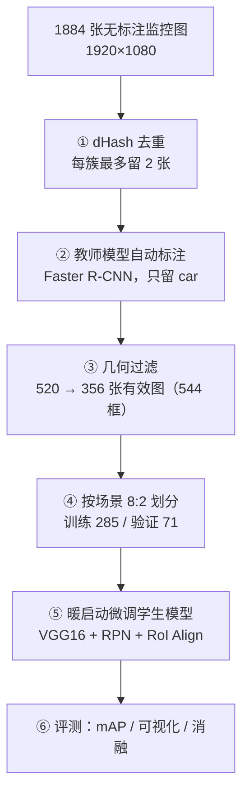

# 交通场景车辆检测：基于伪标签自训练的迁移实验

> 所属课程：神经网络与深度学习综合实训（期中汇报）
> 前置知识：卷积神经网络（CNN）基础、目标检测基本概念

## 核心问题：1884 张没有标注的监控图，怎么训练一个车辆检测模型？

先想一个场景：

你们手上有一批 1884 张交通监控图像（1920×1080），想训练一个「车辆检测」模型——输入一张图，输出图中每辆车的位置（框）和类别（car）。

但问题来了：

- 目标检测是「监督学习」，必须有标注（每辆车画个框 + 标类别）才能训练。
- 这 1884 张图**没有任何人工标注**。
- 一张张手动标注又慢又贵。

那怎么办？

你们给出的答案是：**不花人力标注，用已经训好的模型「自动」打标签，再用这些标签训练新模型。**

这就是「伪标签自训练」的核心思路。

## 一、先认识专业名词

这次涉及的专业名词有以下几个。

| 名词 | 是什么 | 具体作用 |
| --- | --- | --- |
| 目标检测 | 找出图中物体的位置（框）和类别 | 本次要完成的任务 |
| Faster R-CNN | 两阶段目标检测模型 | 本次使用的检测框架 |
| 主干网络 Backbone | 提取图像特征的 CNN（这里是 VGG16） | 把图像变成特征图 |
| RPN | 区域建议网络，生成候选框 | 检测第一阶段 |
| 锚框 Anchor | 预设的框尺寸和长宽比 | RPN 预测的基准框 |
| RoI Align | 把候选框特征对齐到固定大小 | 检测第二阶段，比 RoI Pooling 更精准 |
| 伪标签 Pseudo-label | 由模型自动生成的标签 | 代替人工标注 |
| 自训练 Self-training | 用模型自己的预测再训练自己 | 半监督学习的一种 |
| 暖启动 Warm start | 用已有模型权重初始化再微调 | 小样本迁移的关键 |
| 微调 Fine-tuning | 预训练模型在新任务上继续训练 | 迁移学习的主要方式 |
| mAP@0.5 | IoU 阈值 0.5 时的平均精度 | 目标检测的核心评测指标 |
| IoU | 预测框与真实框的交并比 | 判断「框得准不准」 |
| NMS | 非极大值抑制，去掉重叠重复框 | 后处理，留置信度最高的框 |
| 感知哈希 dHash | 图像的指纹 | 用于找近似重复图 |
| 消融实验 Ablation | 每次只改一个变量，看它对结果的影响 | 归因「哪个设计真正有用」 |

这里重点理解四个东西：

**1. Faster R-CNN 为什么叫「两阶段」**

它分两步：

- 第一阶段：RPN 在特征图上滑动，快速提出一堆「候选框」（可能有物体的地方）。
- 第二阶段：把每个候选框的特征抠出来（RoI Align），再送进全连接层，判断「是不是车」+「框怎么调更准」。

两阶段 = 先「找候选」，再「精细分类回归」。对应地还有单阶段检测器（如 YOLO），一步到位，更快但通常精度略低。

**2. 伪标签自训练**

思路：先用一个「教师模型」给无标注数据打标签（这些标签是模型猜的，所以叫「伪标签」），再用这些伪标签训练「学生模型」。

代价：伪标签有噪声（教师会标错、漏标），学生会学到教师的错误。你们 PPT 里的「验证集标签也是教师生成的」正是这个问题的体现。

**3. 暖启动 vs 从零训练**

从零训练：模型参数随机初始化，小数据下容易过拟合、难收敛。

暖启动：用已有模型（课堂模型）的权重当初始值，再在新数据上微调。模型已经「见过」很多图，起点好，小样本也能训。

**4. mAP 是什么**

目标检测既要「框得准」（位置），又要「分得对」（类别）。mAP（平均精度均值）把这两者综合成一个数。@0.5 表示「预测框和真实框 IoU ≥ 0.5 就算对」。

## 二、为什么走「伪标签自训练」这条路

面对「没标注」这个问题，你们其实有几条路：

| 方案 | 做法 | 问题 |
| --- | --- | --- |
| 人工标注 | 一张张手动画框 | 慢、贵，1884 张工作量巨大 |
| 伪标签自训练 | 用已有模型自动标注 | 伪标签有噪声，但几乎零成本 |
| 弱监督 / 无监督 | 不用框，只用图像级标签 | 更难，效果不稳定 |

你们手上有「课堂 6 图 VOC 上训练好的 Faster R-CNN（mAP@0.5 = 0.940）」，这就是现成的「教师模型」。所以选伪标签自训练是**最自然、最省力的路**。

## 三、全流程分步骤拆解

整个实验可以拆成六步，我们一步步看。

### 第一步：数据去重（1884 → 520）

监控视频抽帧会得到很多**几乎一模一样的相邻帧**。如果不去重，这些重复帧会同时出现在训练集和验证集里，造成「数据泄漏」——模型背答案而不是学检测。

做法：用 **dHash 感知哈希**给每张图算一个 64 位指纹，再用汉明距离聚类，每簇最多保留 2 张。

结果：1884 张 → 520 张候选。

### 第二步：教师模型自动标注

用课堂 Faster R-CNN 逐张推理，生成检测框。只保留：

- 置信度 ≥ 0.45 的框
- 经过 NMS 去重
- 只保留 car 类别

### 第三步：几何过滤（520 → 356）

模型生成的框有很多噪声（太小、太扁、面积占比异常的框基本是误检）。过滤规则：

- 框宽高 ≥ 20 像素
- 长宽比在 0.45 ~ 3.2 之间
- 框面积占全图 0.2% ~ 85%

结果：520 张 → 356 张有效图，共 544 个框。

### 第四步：按场景划分训练 / 验证（285 / 71）

按场景簇做 8:2 划分，而不是随机划分——保证**相似的场景不会既在训练又在验证**，避免泄漏。

### 第五步：暖启动微调学生模型

学生模型结构和教师一样（VGG16 + RPN + RoI Align），但做了三点迁移适配：

- **类别截断**：课堂是 3 类，现在只做 2 类（背景 + car），把检测头截成 2 类
- **暖启动**：RPN 和检测头都用课堂权重初始化，而不是随机初始化
- **特征缓存**：预计算 520 张图的主干特征，训练时间从几十分钟降到几分钟

### 第六步：评测

定量（mAP / P / R / F1）+ 定性（可视化）+ 消融（归因分析）。

## 四、把流程串成一张图

## 五、优化点与消融：哪个设计真正有用

这是报告里最有价值的部分——用消融实验「归因」。

| 改动 | mAP@0.5 | 相对主模型 | 结论 |
| --- | --- | --- | --- |
| 主模型（k-means 锚框 + 暖启动 + 8 epoch） | 0.758 | — | 基线 |
| 沿用课堂锚框 | 0.800 | +0.043 | k-means 锚框是负优化 |
| 检测头随机初始化 | 0.747 | -0.011 | 暖启动有效 |
| 去掉水平翻转 | 0.743 | -0.014 | 翻转增强有效 |
| RoI Pooling 替代 Align | 0.742 | -0.015 | RoI Align 有效 |
| 训练 4 epoch（主 8） | 0.770 | +0.012 | 8 epoch 轻微过拟合 |

三个关键结论：

1. **暖启动贡献最大**：随机初始化检测头会掉点，且训练曲线明显更差（对照组初始损失更高、收敛更慢）。
2. **k-means 锚框是踩坑点**：你们用 k-means 重设了锚框（95 / 97 / 228 像素），但消融发现**沿用课堂锚框反而更高（0.800）**——k-means 出现了尺度冗余。这个「负优化」的诚实发现，反而是报告的亮点。
3. **RoI Align、水平翻转都是小幅正贡献**（各 +0.015 / +0.014）。

## 六、结果怎么读（这步最容易被问倒）

主结果：

| 模型 | mAP@0.5 | mAP@[.5:.95] | P | R | F1 |
| --- | --- | --- | --- | --- | --- |
| 课堂模型（不微调） | 0.894 | 0.606 | 0.867 | 0.874 | 0.870 |
| 新数据微调（本文） | 0.758 | 0.371 | 0.649 | 0.824 | 0.726 |

看数字的时候有两个「坑」必须意识到：

**坑 1：教师是天花板，不能直接用 0.894 压学生。**

验证集的标签是教师模型生成的。教师自己评自己，一致性自然高（0.894）。所以正确的读法是「学生 0.758 达到教师的 85%」，而不是「学生比教师低 0.136 所以退步了」。

**坑 2：这个指标衡量的是「学生和教师的一致性」，不是绝对精度。**

因为「真值」本身就是教师的伪标签，所以 mAP 衡量的其实是「学生学得像不像老师」，而不是「车检得准不准」。真要确认绝对精度，还得有**人工标注的测试集**。

（你们 PPT 里主动承认了这点，还列出了四条不足：伪标签自洽评测、教师只标主车导致选择偏差、类别只有 car、主干冻结未端到端微调。这非常加分。）

## 七、本节知识总结

### 知识卡片：伪标签自训练的迁移实验

**1. 核心问题**

无标注数据怎么用来训练目标检测模型。

**2. 核心思路**

教师模型自动标注（伪标签）→ 过滤 → 暖启动微调学生模型。

**3. 全流程**

去重（dHash）→ 教师标注 → 几何过滤 → 场景划分 → 暖启动微调 → 评测。

**4. 关键优化**

暖启动（贡献最大）、RoI Align、水平翻转；k-means 锚框是负优化（沿用课堂锚框更好）。

**5. 结果读法**

学生 0.758 = 教师的 85%，衡量的是与教师的一致性，不是绝对精度。

**6. 面试关键词**

伪标签、自训练、暖启动、迁移学习、Faster R-CNN、mAP、消融实验、数据泄漏。

## 八、面试表达训练

如果答辩 / 面试被问：

**「你们这个实验的核心思路是什么？怎么解决没有标注的问题？」**

你可以这样回答：

> 我们面对的是 1884 张没有人工标注的交通监控图像，目标检测是有监督任务，直接训练不可行。
>
> 我们的思路是伪标签自训练：先用课堂上训练好的 Faster R-CNN 当教师模型，对这批图自动打标签，再经过几何过滤得到弱标注集，最后用暖启动的方式微调一个学生模型。
>
> 全流程是：感知哈希去重、教师自动标注、几何过滤、按场景划分训练验证集、暖启动微调、定量与消融评测。
>
> 消融实验表明，暖启动的贡献最大；而 k-means 重设锚框反而是负优化，沿用课堂锚框更好。
>
> 最终学生模型 mAP@0.5 达到 0.758，约为教师的 85%。需要说明的是，由于验证标签也来自教师模型，这个指标衡量的是学生与教师的一致性，而不是绝对精度。

## 九、现在检查你的理解

这次是推导题。

**为什么「验证集标签由教师模型生成」会导致指标偏高、不能反映绝对精度？如果现在给你 100 张人工标注的测试图，你会怎么用它得到一个「可信」的精度数字？**

这个问题能检验你是否真正理解了「伪标签评测的偏差」，以及怎么用外部人工标注来校正它。
